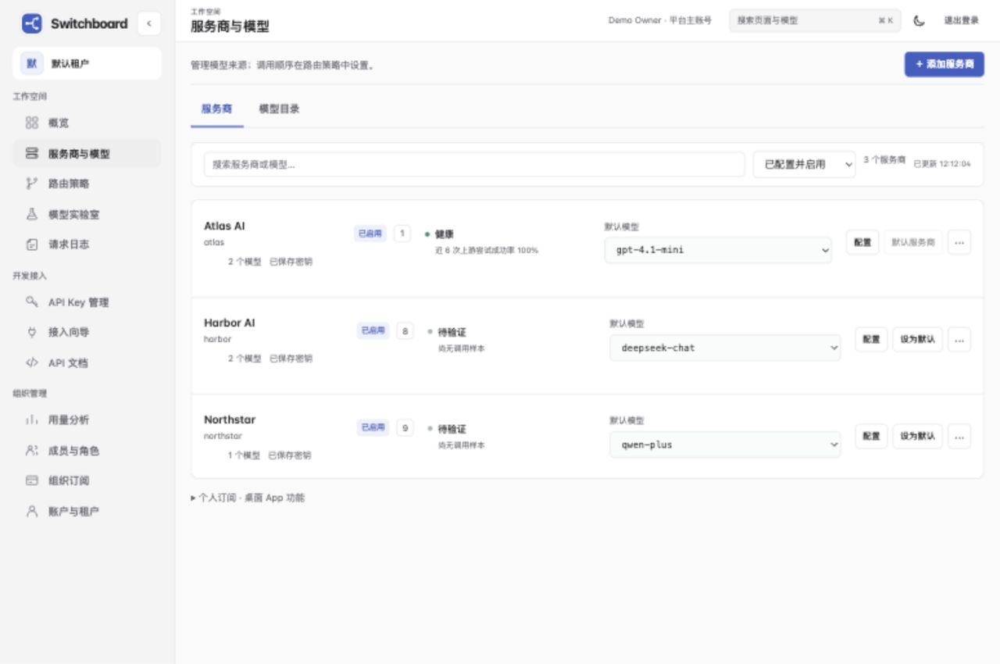
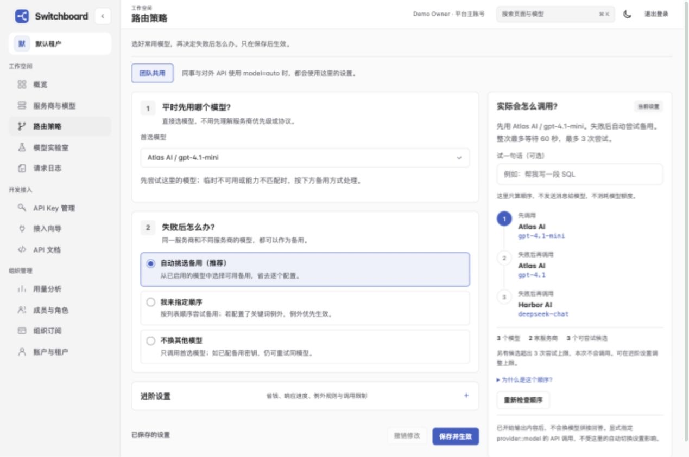
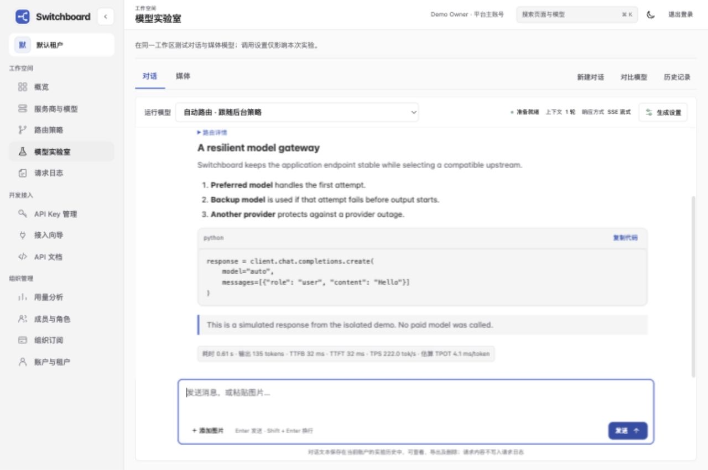
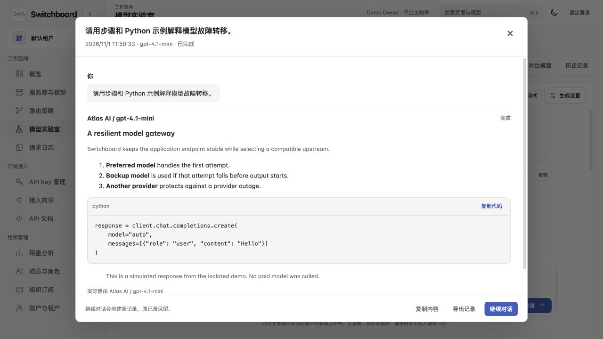
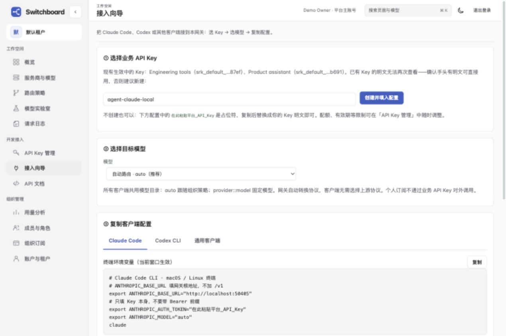
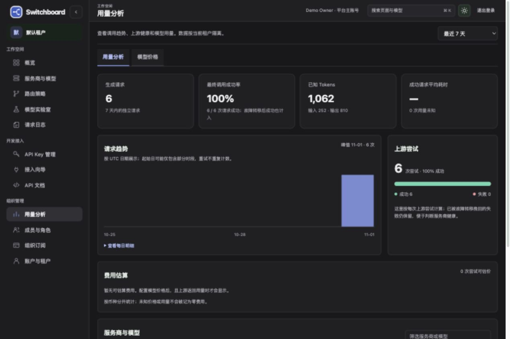

# Switchboard

**Self-hosted AI gateway & model router.** One OpenAI/Anthropic-compatible API for every model provider you use — with routing policies, per-key quotas, multi-tenant teams, usage analytics and a built-in model playground.

**English** | [中文文档](README.zh-CN.md)

[](https://github.com/chensl139-ok/switchboard-ai-router/actions/workflows/ci.yml)
[](https://github.com/chensl139-ok/switchboard-ai-router/releases/latest)
[](LICENSE)
[](https://github.com/chensl139-ok/switchboard-ai-router/pkgs/container/switchboard-ai-router)

## See the workflow

Real captures from the current main branch, using isolated demo accounts and simulated upstreams. These numbers are **not performance benchmarks**. Click an image for the full view.

| 1 · Connect your models | 2 · Plan for failures |
| --- | --- |
| [](docs/demo/providers.jpg) | [](docs/demo/routing.jpg) |
| Enable the models you need. Keep credentials on the server. | Pick a preferred model and backups; preview how many providers your attempt budget covers. |
| **3 · Test a conversation** | **4 · Continue from history** |
| [](docs/demo/playground.jpg) | [](docs/demo/history.jpg) |
| Markdown, code blocks, the actual-hit model and timing metrics. | Search, inspect, export or resume text conversations. New records preserve the original routing selection. |
| **5 · Connect a client** | **6 · Understand usage** |
| [](docs/demo/connect.jpg) | [](docs/demo/analytics.jpg) |
| Copy configuration for Claude Code, Codex or a compatible client with your own business key. | Distinguish final request success from failed upstream attempts, with tenant-scoped usage and reference costs. |

Try it without provider credentials or paid calls: `npm ci && npm run demo`. This creates a temporary loopback-only workspace and prints a demo login. [Demo details](docs/demo/README.md).

## Features

- **Your keys stay on your machine.** Self-hosted BYOK gateway: provider keys are AES-256-GCM encrypted at rest, business API keys are stored hashed, and request logs do not store prompts or responses. Lab history does store conversation text, which users can inspect and delete.
- **Model-level routing.** Pick a preferred model and automatic or ordered backups, with price/latency/weight objectives, keyword exceptions, circuit breaking and a total request timeout.
- **A shared workspace.** Providers, models, experiment history, keys, members and usage in one interface. `⌘K` / `Ctrl+K` searches pages and available models within your current permissions.
- **Local deployment.** One Node.js process with two runtime dependencies (`ws`, `marked`). Native desktop shells use system WebKit on macOS and WebView2 on Windows; no separate Docker or Node installation is needed.

The main branch includes [unreleased interface and workflow improvements](CHANGELOG.md#unreleased). Published v2.2.0 images do not automatically include main-branch commits. Build from source, or use a verified [main-branch image](#container-build-channels) to try the latest changes; back up data before upgrading.

## Quick start (5 minutes)

Requirements: Docker + Compose, and Node.js ≥ 22.18 (only used to generate the initial `.env`).

```sh
git clone https://github.com/chensl139-ok/switchboard-ai-router.git
cd switchboard-ai-router
npm run setup                 # generates ADMIN_TOKEN / GATEWAY_TOKEN once, never overwrites
docker compose up -d --build
```

Open [http://127.0.0.1:3100](http://127.0.0.1:3100), enter the `ADMIN_TOKEN` from `.env` and create the owner account. Then:

1. **Providers & Models** — add an upstream base URL + API key, fetch its model list, enable the models you want to expose.
2. **Routing** — pick a preferred model and choose automatic backups, an ordered list or no model switching. Preview your draft before saving; it never calls upstreams.
3. **Model Lab** — test a call, compare models, run media tasks and resume fully saved text conversations from History.
4. **API Keys** — issue a business key with expiry and quota for your applications.

Call it like any OpenAI-compatible endpoint:

```sh
curl http://127.0.0.1:3100/v1/chat/completions \
  -H 'Authorization: Bearer YOUR_BUSINESS_KEY' \
  -H 'Content-Type: application/json' \
  -d '{"model":"auto","messages":[{"role":"user","content":"hello"}]}'
```

| `model` value | Meaning |
| --- | --- |
| `auto` | Follow the tenant's routing policy; may fall back to compatible providers/models |
| `provider-id` | Use that provider's current model |
| `provider-id::model-id` | Pin provider + model (primary/backup key failover only, no cross-model fallback) |

Responses carry `x-router-provider`, `x-router-model`, `x-router-protocol`, `x-router-attempt` headers so you always know which model actually answered. Point any OpenAI-compatible client (Cherry Studio, NextChat, LobeChat, …) at `http://127.0.0.1:3100/v1` with your business key.

No Docker? `npm ci && npm run setup && npm start`. Prefer not to build? Pull the multi-arch image from [GHCR](https://github.com/chensl139-ok/switchboard-ai-router/pkgs/container/switchboard-ai-router). On Apple Silicon Macs running macOS 13+, the [desktop app](desktop/README.md) bundles its runtime: open the DMG, drag Switchboard into Applications, then launch it from there.

macOS desktop builds currently use ad-hoc signing, without Apple Developer ID signing or notarization; another Mac may block a downloaded copy. The DMG contains no personal credentials or history. Each installation is a separate local platform, not an automatic connection to the sender's organization. See the [sharing notes](desktop/README.md#分享安装包) before distributing it.

A separate [Windows x64 desktop build](desktop/windows/README.md) uses WinForms and system WebView2 with bundled Node. Unzip the sharing package and run Setup.exe; no Docker or Node installation is required. Windows builds are produced by a manual Actions workflow on main, are not yet code-signed, and are not automatically added to existing Releases.

The local development build includes a personal ChatGPT plan connection preview using official OAuth, without an API key. Authorization, account-specific model discovery and text inference have been verified locally. Connections are private to the authorizing platform user and tenant, and are not exposed through shared providers or business API keys. This is not a subscription account pool; see the [desktop guide](desktop/README.md).

Personal routing can combine the caller's authorized subscription models with organization API providers in the lab, using the existing policy and failover engine. It does not change shared routing, stops failover after answer output begins, and never treats unknown subscription pricing as free. Claude subscription OAuth is not implemented without official third-party authorization; Anthropic API support is a separate feature.

## How it works

```
  Cherry Studio · Claude Code · curl · your app · your agents
                    │   one base_url + one API key
                    ▼
  ┌──────────────────────── Switchboard ────────────────────────┐
  │  auth · tenants · API-key quotas · rate limits · audit      │
  │  ─────────────────────────────────────────────────────────  │
  │  router · fixed / failover / weighted / latency / rules /   │
  │           cost     (+ circuit breaking, timeouts)           │
  │  ─────────────────────────────────────────────────────────  │
  │  protocols · OpenAI Chat / Responses / Completions          │
  │              Anthropic Messages · SSE · WebSocket           │
  │              media: image · audio · video · embed · rerank  │
  └────┬──────────┬──────────┬──────────┬───────────┬───────────┘
       ▼          ▼          ▼          ▼           ▼
   DeepSeek    OpenAI    Anthropic    Gemini     Qwen · OpenRouter
                                        · any OpenAI/Anthropic-compatible upstream
```

## Feature map

| Module | Highlights |
| --- | --- |
| Model routing | fixed / failover / weighted / latency-first / keyword rules / cost-first; fallback within and across providers; primary+backup keys per model |
| Protocol gateway | OpenAI Chat Completions, Responses, legacy Completions; Anthropic Messages; SSE; custom WebSocket text protocol |
| Providers & models | preset + custom compatible providers, model discovery, provider-level protocol auto-matching |
| Model Lab | chat with streaming Markdown, image input and function tools; 2–4 model side-by-side comparison; image / audio / video / vision tasks; Kimi K3 video understanding with timestamped frames or native video input; TTFB, TTFT, TPS, est. TPOT metrics with actual-hit model reporting |
| Teams | email+password or Feishu (Lark) OAuth, invites, four roles, tenant isolation, operation audit, password reset codes |
| Task tracing & acceptance | correlate HTTP/SSE chat retries with `X-Task-ID`; separate caller validation from gateway completion, aggregate attempt time and estimated costs by currency ([API guide](API.md#任务关联输出验收与成本追踪)) |
| Business API keys | per-member keys with expiry and quotas, hashed at rest; revocation takes effect on removal |
| Observability | request metadata logs (never prompt bodies), final-success-rate accounting, per-member/model/key usage, cost estimation, OpenRouter reference pricing import |

### Kimi K3 video understanding

In **Model Lab → Chat**, select a configured `kimi-k3`, attach a video and ask follow-up questions in the same conversation. This uses frame sampling and keeps the selected model fixed. Reloaded history includes text only, so video conversations require reattaching the source to resume.

In **Model Lab → Media → Visual understanding**, select **Video** and your configured `kimi-k3`. The default frame-sampling mode reads a local MP4/WebM/MOV (up to 6 MB / 10 minutes), sends up to 12 timestamped frames, and saves the text result in experiment history. It does not analyze audio and may miss brief events. Videos and frame images are not stored in history.

Native mode uses `POST /v1/chat/completions` with a `video_url` content block. HTTPS URLs, video Base64 and `ms://` file references require upstream support; a channel accepting text/images may reject native video. For `ms://`, use a file uploaded through the same upstream account, an explicit `provider::kimi-k3`, and `allow_fallback: false`. Switchboard does not provide the upstream file-upload endpoint. The in-app API guide includes an example. See [Kimi visual-input documentation](https://platform.kimi.com/docs/guide/use-kimi-vision-model).

## Routing you can inspect

The policy editor separates preferred model, backup behavior and optional optimization. Previewing a draft does not save it or call a model.

| Objective / protection | Behavior |
| --- | --- |
| Priority | Preferred model first; automatic fallback reserves room for another provider |
| Latency | Compare recent model-level successful samples, including models within one provider; at least three samples are required |
| Cost | Compare valid same-currency reference prices; unknown prices are not free |
| Weight | Weighted provider rotation with model-level fallback |
| Ordered backups | Follow an explicit candidate sequence |
| Attempt budget | Counts actual attempts, including alternate credentials; preview shows effective coverage |
| Total timeout | Divide remaining time across remaining eligible attempts, not nonexistent candidates |

Reference prices are estimates, not supplier invoices. Imported OpenRouter reference prices have lower priority than manual or provider-native prices. Organization subscription plans are a BYOK framework with the payment wall off; wallet top-ups and live payment checkout are not implemented.

## Deployment & security notes

- **Single-instance by design**: config in files, usage in SQLite, rate limiting in-process. Never share one `data/` directory between processes; put it behind an HTTPS reverse proxy and back it up regularly (including `master.key`).
- SSRF guard: non-HTTPS upstreams and private/reserved hosts are refused by default; allow-list explicitly if you must.
- Hardened Compose profile: read-only rootfs, `no-new-privileges`, tmpfs `/tmp`, health checks, graceful shutdown.
- Pre-built `linux/amd64` + `linux/arm64` images on GHCR: stable `2.2.0` / `2.2` / `latest`, separately from main-branch builds; releases ship offline OCI tarballs with `SHA256SUMS`.

Full details: [TENANCY.md](TENANCY.md) (roles & Feishu/Lark SSO), [API.md](API.md) (endpoints, media APIs, SDK notes), [ARCHITECTURE.md](ARCHITECTURE.md) (module boundaries), [CHANGELOG.md](CHANGELOG.md). Some deep-dive docs are currently in Chinese — translations are very welcome.

### Container build channels

| Tag | Content | Updated by |
| --- | --- | --- |
| `2.2.0`, `2.2`, `latest` | Published stable release | Version-tag release workflow |
| `main` | Most recent tested main-branch image, not a release | Manual [Main branch image workflow](https://github.com/chensl139-ok/switchboard-ai-router/actions/workflows/image-main.yml) |
| `sha-<full commit SHA>` | Traceable main-branch build | Same workflow; prefer its image digest for exact pinning |

All images use `ghcr.io/chensl139-ok/switchboard-ai-router`. The main workflow tests the application and starts an isolated Linux container before publishing both architectures. It does not change stable tags or create a Release. A git push alone runs CI, not image publication. Desktop Windows installers are separate [workflow artifacts](https://github.com/chensl139-ok/switchboard-ai-router/actions/workflows/windows-desktop.yml), retained for 14 days; download them promptly if you need a lasting copy.

## Verify your deployment

Desktop and Docker share core code but keep separate data directories. Updating one does not update the other or a remote server. See [upgrade and backup guidance](docs/OPERATIONS.md).

```sh
npm run doctor -- --url http://127.0.0.1:3100
# Compare with a running desktop instance (use its actual port):
npm run doctor -- --url http://127.0.0.1:3100 --url http://127.0.0.1:3110
```

Doctor checks readiness and the shared build fingerprint without credentials or model calls. Matching code does not imply shared data. The same fingerprint is shown under Account & Tenants.

## Development

```sh
npm ci
npm run check    # syntax, TypeScript/Vue types, web build
npm test         # automated unit/integration tests
npm start        # build web assets and serve locally
npm run demo     # disposable workspace with simulated upstreams
```

Push a `v*` tag to cut a release: CI runs checks and tests, builds multi-arch GHCR images, and generates release notes with offline bundles.

## Disclaimer

Switchboard is a neutral routing tool. You are responsible for complying with each model provider's terms of service and applicable laws/regulations, and you must not use this project to offer AI services to the public without authorization.

## Star history

If Switchboard saves you a deployment, a debugging session or a surprise bill — a ⭐ is the best fuel for the next release.

[](https://star-history.com/#chensl139-ok/switchboard-ai-router&Date)

## License

[MIT](LICENSE) © 2026 chensl139-ok · Maintainer: [15652641985@163.com](mailto:15652641985@163.com)
