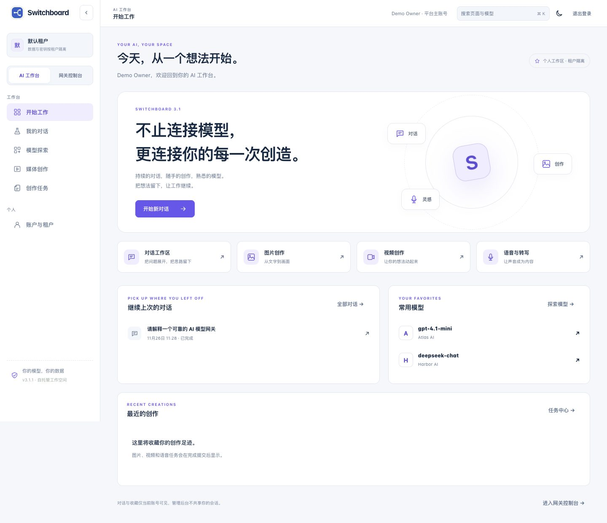
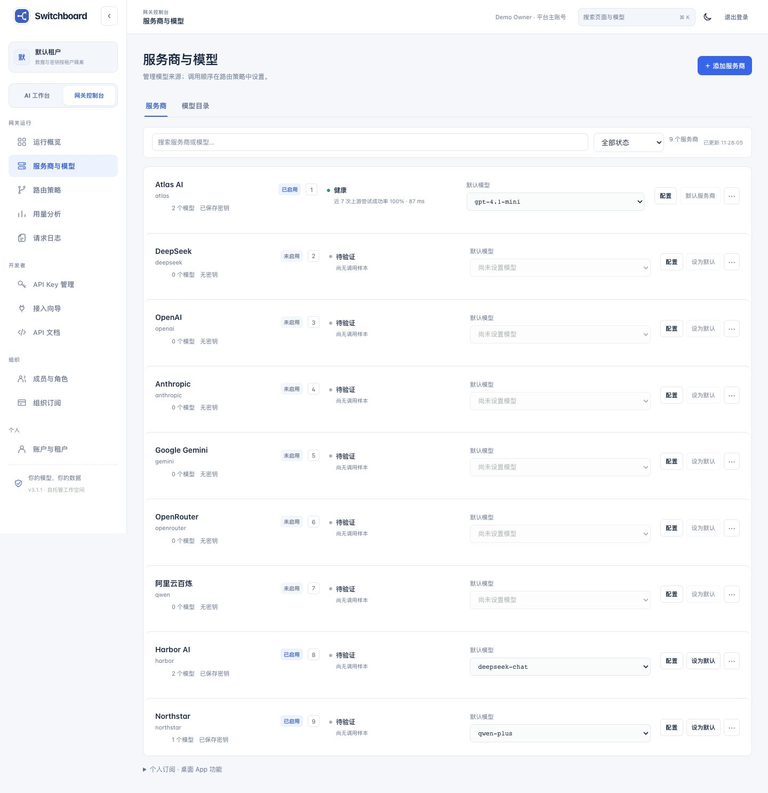
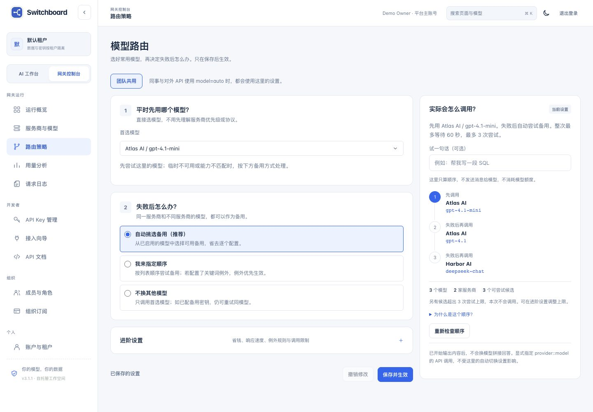
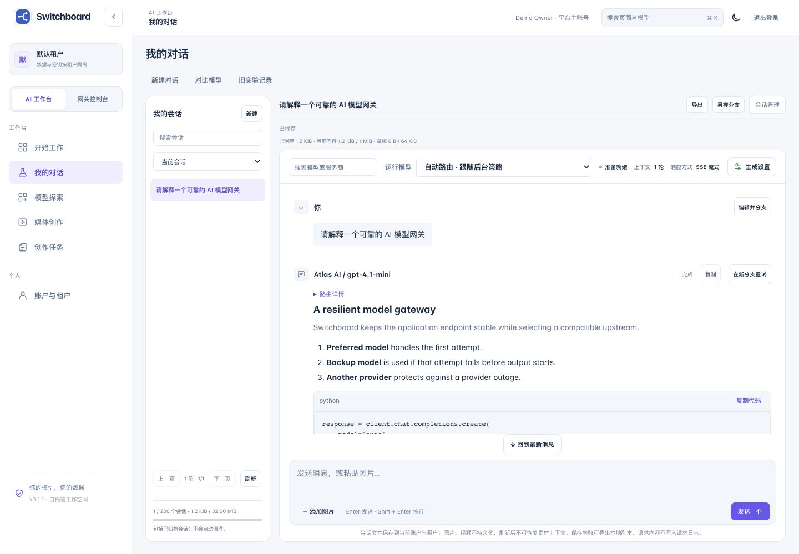
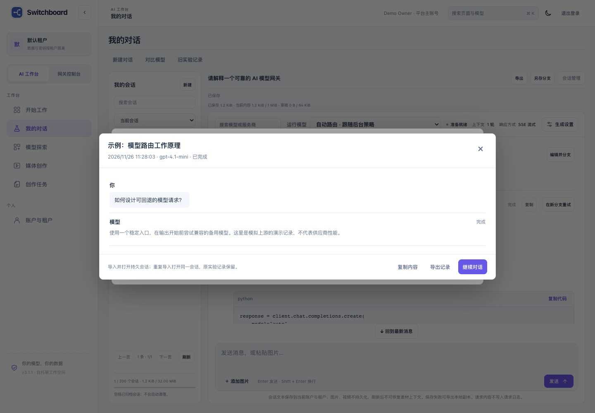
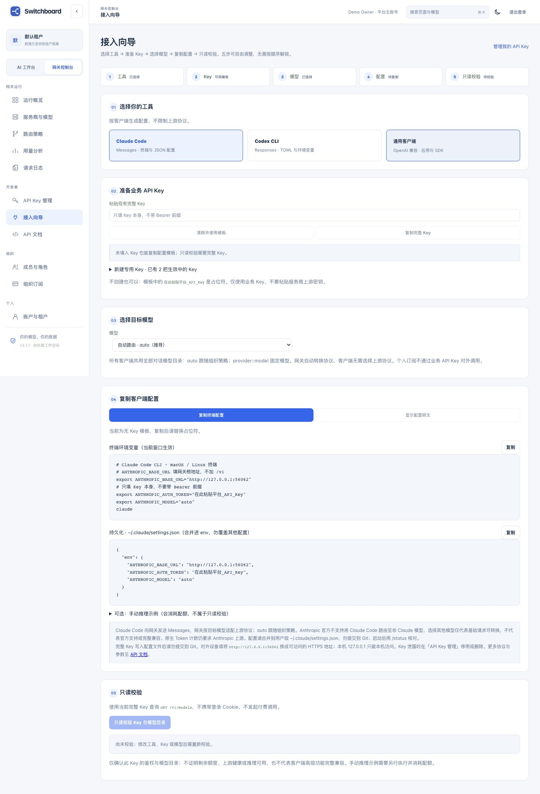
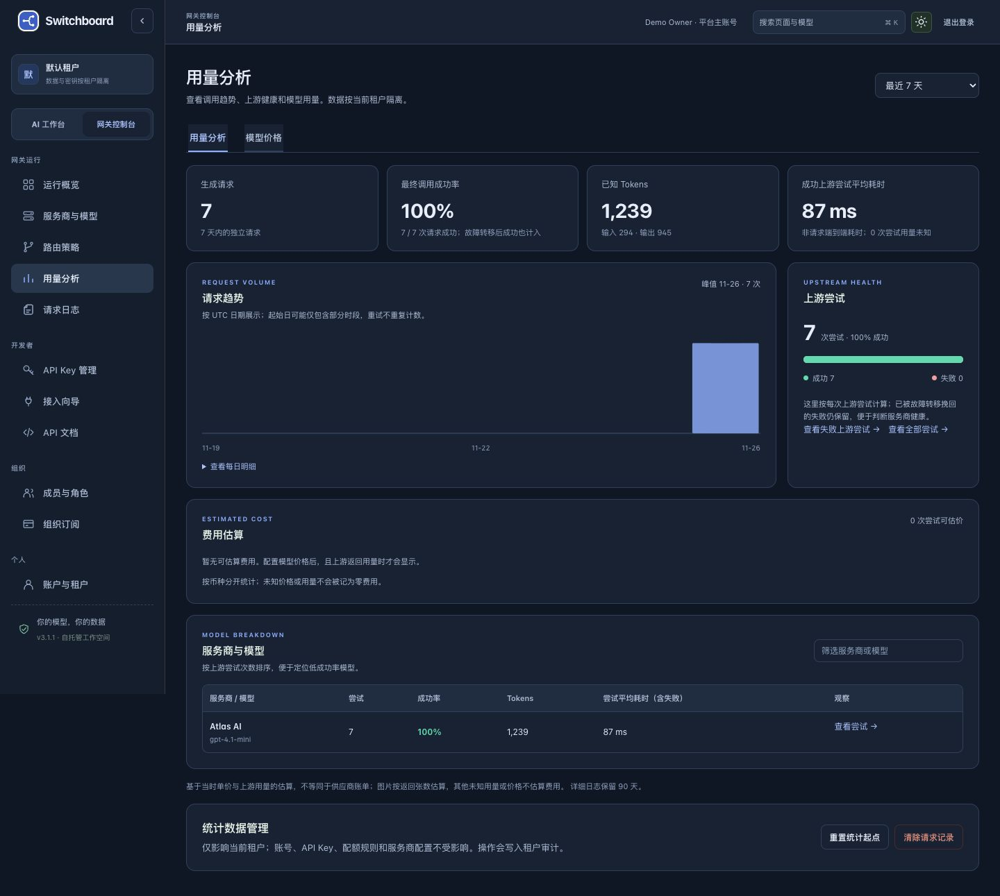

# Switchboard

**A self-hosted AI workspace and model-routing gateway.** Keep personal conversations and drafts in the workspace; manage providers, routing, business API keys and usage in the gateway. One OpenAI/Anthropic-compatible API for your configured providers, with tenant isolation and explicit compatibility limits.

**English** | [中文文档](README.zh-CN.md)

[](https://github.com/chensl139-ok/switchboard-ai-router/actions/workflows/ci.yml)
[](https://github.com/chensl139-ok/switchboard-ai-router/releases/latest)
[](LICENSE)
[](https://github.com/chensl139-ok/switchboard-ai-router/pkgs/container/switchboard-ai-router)

**Version 3.1.2 · 2026-11-26.** This patch adds reliable deletion of creation-task records from cards and details, retaining the existing workspace and persistent conversations. Source changes and published images are separate: check the release and image tag before upgrading. See [release notes](CHANGELOG.md), [upgrade guidance](docs/OPERATIONS.md) and the actual [GitHub Releases](https://github.com/chensl139-ok/switchboard-ai-router/releases).

## See the workflow

The tour uses isolated demo accounts and simulated upstreams, not real tenant data. Its numbers are **not performance benchmarks**. [Reproduction and capture checklist](docs/demo/README.md).

[](docs/demo/workspace.jpg)

| 1 · Connect your models | 2 · Plan for failures |
| --- | --- |
| [](docs/demo/providers.jpg) | [](docs/demo/routing.jpg) |
| Enable the models you need; keep credentials on the server. | Choose a preferred model and backups; preview attempt coverage without calling upstreams. |
| **3 · Work in a conversation** | **4 · Inspect history** |
| [](docs/demo/playground.jpg) | [](docs/demo/history.jpg) |
| Persistent personal conversations, drafts, streaming Markdown and actual-hit model details. | Short-term experiment snapshots are separate from persistent conversations. |
| **5 · Connect a client** | **6 · Understand usage** |
| [](docs/demo/connect.jpg) | [](docs/demo/analytics.jpg) |
| Use your business key with a compatible client; see the documented CLI limitations. | Distinguish final request success, failed upstream attempts and caller acceptance. |

Try without provider credentials or paid calls: `npm ci && npm run demo`. It creates a temporary loopback-only workspace and prints a demo login. Do not enter sensitive information.

## Workspace and gateway

- **Workspace:** personal conversations and drafts, search, pin/archive/delete, model favorites, media tasks and model comparison. Conversations and favorites belong to the current user **within the current tenant**, not to the entire team.
- **Gateway:** organization providers, model discovery, routing, business API keys, members, logs, pricing and usage. `⌘K` / `Ctrl+K` searches pages and available models within your permissions.
- **Self-hosted BYOK:** provider credentials are AES-256-GCM encrypted at rest; business API keys are hashed. Request/audit logs do not store prompts or responses, but conversations, drafts and experiment history **do store text**. Protect the host and backups; do not enter secrets into demo data.
- **Single-instance deployment:** one Node.js process; files for configuration and SQLite for usage and workspace records. Never share one data directory between processes.

### Conversations are not disposable history

Opening **New conversation** leaves a local blank draft, not a database record. Ordinary autosave starts with the first text; explicit send, metadata changes or branch creation may also persist a record. Automatic titles are derived locally from the first user text, without a model call or charge. Existing and manually renamed titles are protected; `titleMode` is server-managed.

Editing a user message creates a **new branch draft**, without sending it. Retrying an assistant answer requires confirmation of possible charges and creates a new branch; it does not overwrite the original answer. Export as JSON, Markdown or text; Markdown/text omit thinking by default. Review JSON before sharing because it can include stored thinking and metadata.

Image/video/audio inputs are not permanent assets. After reload, missing attachments or tool context prevent continuing the original context; text-only storage is not a lossless multimodal archive. Media task **status queries** and **regeneration** are separate actions: regeneration is a new potentially billable call, and result URLs may expire. Cards and details offer **Delete record** for your current-tenant history only; deletion does not cancel upstream work, issue a refund, or remove external files or usage logs. Pending tasks may still incur charges. [Creation-task view](docs/demo/tasks.jpg).

Writes use revision-based compare-and-swap (CAS). Runs have a `runId` and a 120-second lease, renewed every 25 seconds with output checkpoints at 5-second intervals. A conflict requires reloading and confirmation, not silent overwrite. Delete does not create a replacement conversation: 404 removes the stale local entry; 409 requires reload and confirmation; network failure retains the local copy. If creation may have succeeded but its response was lost, export the local copy and refresh to reconcile IDs—never delete by guessing a title.

| Persistent conversation limit | Scope |
| --- | --- |
| 1 MiB per conversation, including draft/settings | Serialized text payload |
| 64 KiB per draft | UTF-8 bytes |
| 200 conversations / 32 MiB | One user in one tenant, including archived conversations |
| 256 MiB / 1 GiB | Tenant / global conversation payload totals |

Reaching a limit rejects the save; it does not silently prune conversations. The old `history` store still keeps 100 snapshots per user/tenant and 5,000 globally, independently. Complete eligible text snapshots can be explicitly imported; incomplete, missing-attachment or tool histories cannot. See [workspace API](API.md#工作台会话与偏好接口) and [migration guidance](docs/OPERATIONS.md#首次工作台升级与数据迁移).

## Quick start

Requirements: Docker + Compose, and Node.js ≥ 22.18 to generate the initial configuration. This builds your checked-out source, not an automatically selected stable release.

```sh
git clone https://github.com/chensl139-ok/switchboard-ai-router.git
cd switchboard-ai-router
npm run setup                 # creates initial tokens; never overwrites an existing .env
docker compose up -d --build
```

Open [http://127.0.0.1:3100](http://127.0.0.1:3100), use the local `ADMIN_TOKEN` to initialize the owner account, then set email/password. Do not share initialization tokens or commit `.env`.

1. **Providers & Models:** add an upstream base URL and API key, discover models and enable those you need.
2. **Routing:** select a preferred model and automatic, ordered or disabled model fallback. Draft preview does not call upstreams or save settings.
3. **Workspace:** test a conversation or an appropriate media task with your configured model.
4. **API Keys:** issue your own business key with expiry and quota; initialization tokens are not application keys.

```sh
curl http://127.0.0.1:3100/v1/chat/completions \
  -H 'Authorization: Bearer YOUR_BUSINESS_KEY' \
  -H 'Content-Type: application/json' \
  -d '{"model":"auto","messages":[{"role":"user","content":"hello"}]}'
```

| `model` value | Meaning |
| --- | --- |
| `auto` | Follow the tenant routing policy, with compatible fallback candidates |
| `provider-id` | Use that provider's current model |
| `provider-id::model-id` | Pin provider + model; same-model credential failover only |

Responses include `x-router-provider`, `x-router-model`, `x-router-protocol` and `x-router-attempt`. Compatible OpenAI clients use `http://127.0.0.1:3100/v1` and a business key. Responses support is a **stateless subset**, not full Codex compatibility. Protocol translation to non-Claude models is not official Claude Code support. See [API and CLI boundaries](API.md#sdk).

### Prebuilt containers

After **3.1.2 has actually been published**, initialize configuration once in the repository directory, then use the pinned image:

```sh
npm run setup
mkdir -p data
docker pull ghcr.io/chensl139-ok/switchboard-ai-router:3.1.2
docker run -d --name switchboard-ai-router \
  --restart unless-stopped \
  -p 127.0.0.1:3100:3000 --env-file .env \
  -e HOST=0.0.0.0 -e PORT=3000 -e DATA_DIR=/app/data \
  -v "$PWD/data:/app/data" \
  ghcr.io/chensl139-ok/switchboard-ai-router:3.1.2
```

Choose **either** this method **or** Compose; do not run both on the same port/data. Preserve all original options when recreating an existing container. Offline Release assets contain source ZIP/TGZ, an OCI image bundle and `SHA256SUMS`. See [operations](docs/OPERATIONS.md).

### Docker API gateway vs. desktop personal subscriptions

Docker provides the organization BYOK API gateway and browser workspace. It does **not** turn personal subscriptions into a shared provider/account pool or expose them through business API keys.

The [macOS desktop app](desktop/README.md) bundles Node and uses system WebKit; it targets macOS 13+ on Apple Silicon. Current packages use ad-hoc signing without Apple Developer ID signing or notarization. Each installation has independent data and does not automatically join another person's organization. A separate [Windows x64 build](desktop/windows/README.md) uses WinForms/WebView2 with bundled Node; it is unsigned and built by a manual workflow, not automatically attached to existing Releases.

The local desktop personal ChatGPT connection preview uses official OAuth. It is private to the authorizing user and tenant. Personal routing can combine their authorized subscription models and organization API models for personal lab calls, without changing shared routing. Unknown subscription prices are not free; failover stops after answer output starts. Earlier local verification is not a guarantee for every account or this release: this documentation update does not claim a new live OAuth or upstream test. Claude subscription OAuth is not implemented without official third-party authorization; Anthropic API support is separate.

No Docker? Use `npm ci && npm run setup && npm start` (source default port 3000; set your intended host/port). Desktop and Docker are separate installations even when code fingerprints match.

## Gateway capabilities and limits

| Module | Highlights |
| --- | --- |
| Routing | Fixed, failover, weighted, latency-first, keyword rules and cost-first; model-level fallback within/across providers; primary/backup credentials |
| Protocols | OpenAI Chat, stateless Responses, legacy Completions, Anthropic Messages, SSE and a custom WebSocket text protocol—not official Realtime |
| Chat & comparison | Streaming Markdown, images and caller-executed function tools; 2–4 model comparison; actual-hit model, TTFB, TTFT, end-to-end TPS and estimated TPOT |
| Media | Image/audio/video/vision tasks; dedicated API endpoints for editing, translation, embedding and reranking as supported by upstreams |
| Teams | Email/password, optional Feishu/Lark OAuth, invites, four roles, password reset codes, tenant isolation and audit |
| Task tracking | `X-Task-ID` for ordinary HTTP/SSE chat, caller acceptance feedback and per-currency estimated costs; [API guide](API.md#任务关联输出验收与成本追踪) |
| Business keys & usage | Per-user keys, expiry, quotas and revocation; metadata logs, final-request success and member/model/key usage |

Latency ranking requires at least three recent successful model samples. Cost ranking compares valid same-currency reference prices; unknown prices are not zero. Attempt budgets include alternate credentials; timeouts divide remaining time across actual eligible attempts. Routing previews show effective coverage and exclusions.

Reference prices are estimates, not invoices. Manual/provider-native prices take precedence over imported OpenRouter references. Organization subscription plans remain a BYOK framework with the payment wall off; live payments and wallet top-ups are not implemented.

**Kimi K3 video:** chat supports timestamped frame sampling and follow-up while the source context remains available. Media visual understanding accepts MP4/WebM/MOV up to 6 MB / 10 minutes, samples up to 12 frames, excludes audio and may miss brief events. Native `video_url` support depends on the upstream; `ms://` requires the same upstream account, an explicit `provider::kimi-k3` and `allow_fallback: false`. No upstream file-upload proxy is provided. See [API details](API.md#kimi-k3-视频理解).

**Media boundaries:** use an explicit configured media model, not chat `auto`; video generation currently uses SiliconFlow's asynchronous API. MOSS-VL is a single-turn synchronous visual task, not ordinary text chat. MOSS image controls and prompt enhancement depend on upstream capabilities; no fresh real-provider result is asserted here.

## Security, upgrades and release channels

- Back up **all** of `data/`, including `master.key` and SQLite files, and preserve configuration. Stop the instance first for consistency. Losing the master key makes stored provider credentials unreadable.
- Use an HTTPS reverse proxy for public access and enable secure cookies. The Compose profile binds to loopback and uses a read-only root filesystem, tmpfs and health checks.
- Non-HTTPS/private/reserved upstream targets are refused by default; allow-list only intentional trusted exceptions.
- Existing Feishu bindings and encrypted credentials should be preserved during upgrade. Recheck callback origin, application scope and account linkage; **live Feishu OAuth scanning has not been verified for this release**. See [tenancy and SSO](TENANCY.md).

### Container build channels

| Tag | Content | Updated by |
| --- | --- | --- |
| `3.1.2`, `3.1`, `latest` | Target stable release, available only after successful publication | `v*` tag → checks/tests → multi-arch GHCR → Release assets |
| `main` | Latest manually published main build, not a stable release | Manual [Main branch image workflow](https://github.com/chensl139-ok/switchboard-ai-router/actions/workflows/image-main.yml) on main |
| `sha-<full commit SHA>` | Traceable main build | Same workflow; use a digest for exact pinning |

All images use `ghcr.io/chensl139-ok/switchboard-ai-router`, with `linux/amd64` and `linux/arm64`. A main build does not overwrite `latest`, publish stable version tags or create a Release. Pushing main alone runs CI; it does not publish an image. Windows installers are separate [workflow artifacts](https://github.com/chensl139-ok/switchboard-ai-router/actions/workflows/windows-desktop.yml), retained for 14 days.

## Verify and develop

```sh
npm ci
npm run check    # syntax, TypeScript/Vue types, web build
npm test         # automated tests; consult the actual run for results
npm start        # build web assets and serve locally
npm run demo     # disposable simulated environment
npm run doctor -- --url http://127.0.0.1:3100
# Compare with the actual port shown by a running desktop instance:
npm run doctor -- --url http://127.0.0.1:3100 --url http://127.0.0.1:3110
```

Doctor checks readiness and build fingerprints without credentials or model calls. Matching code does not imply shared data. The previous workspace release included an authorized bounded real text check; the task-deletion patch uses isolated media simulators without new paid calls. Simulated media tests do not establish real-provider performance, billing or complete OAuth success. See the [functional validation matrix](docs/VALIDATION.md).

Further reading: [API](API.md) · [Tenancy & Feishu](TENANCY.md) · [Architecture](ARCHITECTURE.md) · [Operations & migration](docs/OPERATIONS.md) · [Changelog](CHANGELOG.md) · [Release maintenance](.github/RELEASING.md).

## Disclaimer

Switchboard is a neutral routing tool. You are responsible for complying with each provider's terms and applicable laws. Do not use this project to offer AI services to the public without authorization. Interface availability does not imply official provider endorsement or complete client compatibility.

## Star history

If Switchboard helps, consider starring the project.

[](https://star-history.com/#chensl139-ok/switchboard-ai-router&Date)

## License

[MIT](LICENSE) © 2026 chensl139-ok · Maintainer: [15652641985@163.com](mailto:15652641985@163.com)
