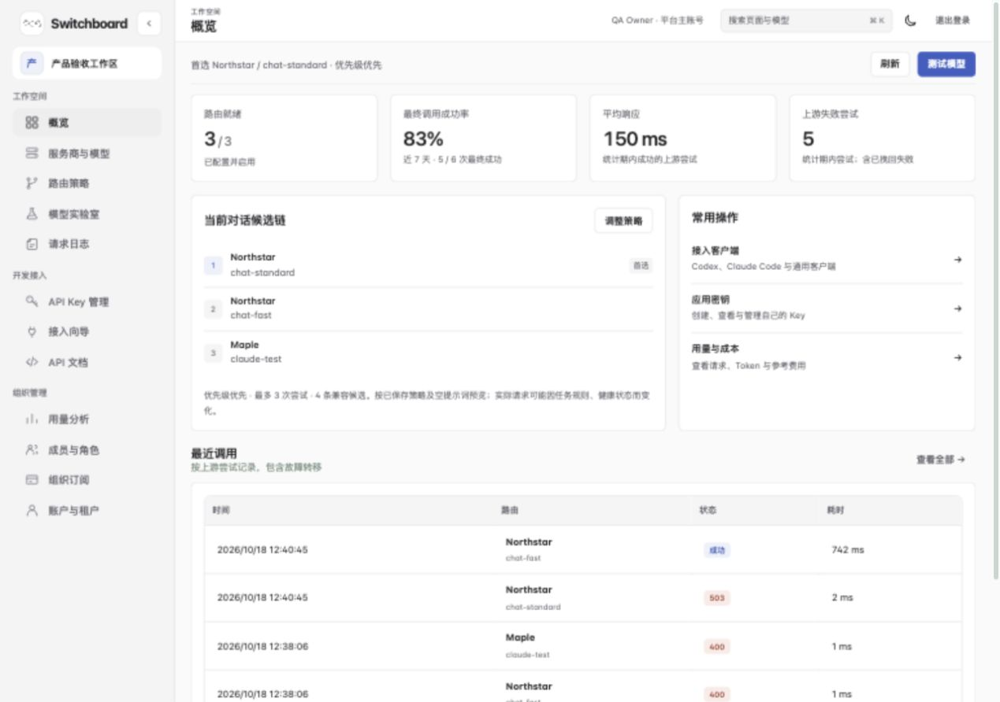

# Switchboard

**Self-hosted AI gateway & model router.** One OpenAI/Anthropic-compatible API for every model provider you use — with routing policies, per-key quotas, multi-tenant teams, usage analytics and a built-in model playground.

**English** | [中文文档](README.zh-CN.md)

[](https://github.com/chensl139-ok/switchboard-ai-router/actions/workflows/ci.yml)
[](https://github.com/chensl139-ok/switchboard-ai-router/releases/latest)
[](LICENSE)
[](https://github.com/chensl139-ok/switchboard-ai-router/pkgs/container/switchboard-ai-router)



## Features

- **Your keys stay on your machine.** Self-hosted BYOK gateway: provider keys are AES-256-GCM encrypted at rest, business API keys are stored hashed, and prompts/responses are never written to logs.
- **Model-level routing.** Pick a preferred model and automatic or ordered backups, with price/latency/weight objectives, keyword exceptions, circuit breaking and a total request timeout.
- **A shared workspace.** Providers, models, experiment history, keys, members and usage in one interface. `⌘K` / `Ctrl+K` searches pages and available models within your current permissions.
- **Local deployment.** One Node.js process with two runtime dependencies (`ws`, `marked`). The macOS app uses system WebKit and bundles its runtime; no separate Docker or Node installation is needed.

The main branch includes [unreleased interface and workflow improvements](CHANGELOG.md#unreleased). Published v2.2.0 images do not automatically include main-branch commits; build from source to try the latest changes.

## Quick start (5 minutes)

Requirements: Docker + Compose, and Node.js ≥ 22.18 (only used to generate the initial `.env`).

```sh
git clone https://github.com/chensl139-ok/switchboard-ai-router.git
cd switchboard-ai-router
npm run setup                 # generates ADMIN_TOKEN / GATEWAY_TOKEN once, never overwrites
docker compose up -d --build
```

Open [http://127.0.0.1:3100](http://127.0.0.1:3100), enter the `ADMIN_TOKEN` from `.env` and create the owner account. Then:

1. **Providers & Models** — add an upstream base URL + API key, fetch its model list, enable the models you want to expose.
2. **Routing** — pick a preferred model and choose automatic backups, an ordered list or no model switching. Preview your draft before saving; it never calls upstreams.
3. **Model Lab** — test a call, compare models, run media tasks and resume fully saved text conversations from History.
4. **API Keys** — issue a business key with expiry and quota for your applications.

Call it like any OpenAI-compatible endpoint:

```sh
curl http://127.0.0.1:3100/v1/chat/completions \
  -H 'Authorization: Bearer YOUR_BUSINESS_KEY' \
  -H 'Content-Type: application/json' \
  -d '{"model":"auto","messages":[{"role":"user","content":"hello"}]}'
```

| `model` value | Meaning |
| --- | --- |
| `auto` | Follow the tenant's routing policy; may fall back to compatible providers/models |
| `provider-id` | Use that provider's current model |
| `provider-id::model-id` | Pin provider + model (primary/backup key failover only, no cross-model fallback) |

Responses carry `x-router-provider`, `x-router-model`, `x-router-protocol`, `x-router-attempt` headers so you always know which model actually answered. Point any OpenAI-compatible client (Cherry Studio, NextChat, LobeChat, …) at `http://127.0.0.1:3100/v1` with your business key.

No Docker? `npm ci && npm run setup && npm start`. Prefer not to build? Pull the multi-arch image from [GHCR](https://github.com/chensl139-ok/switchboard-ai-router/pkgs/container/switchboard-ai-router). On Apple Silicon Macs running macOS 13+, the [desktop app](desktop/README.md) bundles its runtime: open the DMG, drag Switchboard into Applications, then launch it from there.

Desktop builds currently use ad-hoc signing, without Apple Developer ID signing or notarization; another Mac may block a downloaded copy. The DMG contains no personal credentials or history. Each installation is a separate local platform, not an automatic connection to the sender's organization. See the [sharing notes](desktop/README.md#分享安装包) before distributing it.

The local development build includes a personal ChatGPT plan connection preview using official OAuth, without an API key. Authorization, account-specific model discovery and text inference have been verified locally. Connections are private to the authorizing platform user and tenant, and are not exposed through shared providers or business API keys. This is not a subscription account pool; see the [desktop guide](desktop/README.md).

Personal routing can combine the caller's authorized subscription models with organization API providers in the lab, using the existing policy and failover engine. It does not change shared routing, stops failover after answer output begins, and never treats unknown subscription pricing as free. Claude subscription OAuth is not implemented without official third-party authorization; Anthropic API support is a separate feature.

## How it works

```
  Cherry Studio · Claude Code · curl · your app · your agents
                    │   one base_url + one API key
                    ▼
  ┌──────────────────────── Switchboard ────────────────────────┐
  │  auth · tenants · API-key quotas · rate limits · audit      │
  │  ─────────────────────────────────────────────────────────  │
  │  router · fixed / failover / weighted / latency / rules /   │
  │           cost     (+ circuit breaking, timeouts)           │
  │  ─────────────────────────────────────────────────────────  │
  │  protocols · OpenAI Chat / Responses / Completions          │
  │              Anthropic Messages · SSE · WebSocket           │
  │              media: image · audio · video · embed · rerank  │
  └────┬──────────┬──────────┬──────────┬───────────┬───────────┘
       ▼          ▼          ▼          ▼           ▼
   DeepSeek    OpenAI    Anthropic    Gemini     Qwen · OpenRouter
                                        · any OpenAI/Anthropic-compatible upstream
```

## Feature map

| Module | Highlights |
| --- | --- |
| Model routing | fixed / failover / weighted / latency-first / keyword rules / cost-first; fallback within and across providers; primary+backup keys per model |
| Protocol gateway | OpenAI Chat Completions, Responses, legacy Completions; Anthropic Messages; SSE; custom WebSocket text protocol |
| Providers & models | preset + custom compatible providers, model discovery, provider-level protocol auto-matching |
| Model Lab | chat with streaming Markdown, image input and function tools; 2–4 model side-by-side comparison; image / audio / video / vision tasks; TTFB, TTFT, TPS, est. TPOT metrics with actual-hit model reporting |
| Teams | email+password or Feishu (Lark) OAuth, invites, four roles, tenant isolation, operation audit, password reset codes |
| Business API keys | per-member keys with expiry and quotas, hashed at rest; revocation takes effect on removal |
| Observability | request metadata logs (never prompt bodies), final-success-rate accounting, per-member/model/key usage, cost estimation, OpenRouter reference pricing import |

## Comparison

Snapshot October 2026 — check each project's latest docs, and please PR corrections.

| | Switchboard | LiteLLM | one-api | new-api | claude-code-router |
| --- | --- | --- | --- | --- | --- |
| License | **MIT** | MIT core + enterprise dir | MIT | AGPL-3.0 + extra terms | MIT |
| Runtime | Node.js · **2 runtime deps** | Python SDK + proxy | Go single binary | Go single binary | Node CLI |
| Web console | ✅ (CN-first, EN i18n planned) | ✅ | ✅ | ✅ | CLI-first |
| Routing strategies | Fixed / auto; 4 objectives + rules + failover | broad | channel fallback | channel + convert | per-agent rules |
| Protocol conversion | OpenAI Chat / Responses / Completions + Anthropic Messages | broadest (100+ providers) | OpenAI-compatible | OpenAI / Claude / Gemini | agent-focused |
| Multi-tenant RBAC + audit | ✅ built-in | enterprise tier | 🔶 basic users/groups | 🔶 basic users/groups | ❌ |
| Model playground & compare | ✅ with latency metrics | 🔶 dashboard test | 🔶 | 🔶 | ❌ |
| Media tasks (img/audio/video/embed/rerank) | ✅ | ✅ | 🔶 | ✅ | ❌ |
| Credit/billing & redemption codes | paywall off (BYOK plan drafts) | 🔶 budgets | ✅ | ✅ | ❌ |
| Desktop app | ✅ macOS | ❌ | ❌ | ❌ | CLI |

**When Switchboard is *not* the right pick:** you need 100+ exotic providers out of the box (LiteLLM), you run a public key-reselling storefront with redemption codes (one-api / new-api), or you want a personal CLI shim for one coding agent (claude-code-router). Switchboard is built for **individuals and teams who self-host one governed gateway** for many providers.

## Deployment & security notes

- **Single-instance by design**: config in files, usage in SQLite, rate limiting in-process. Never share one `data/` directory between processes; put it behind an HTTPS reverse proxy and back it up regularly (including `master.key`).
- SSRF guard: non-HTTPS upstreams and private/reserved hosts are refused by default; allow-list explicitly if you must.
- Hardened Compose profile: read-only rootfs, `no-new-privileges`, tmpfs `/tmp`, health checks, graceful shutdown.
- Pre-built `linux/amd64` + `linux/arm64` images on GHCR, tagged `2.1.x` / `2.1` / `latest`; releases ship offline OCI tarballs with `SHA256SUMS`.

Full details: [TENANCY.md](TENANCY.md) (roles & Feishu/Lark SSO), [API.md](API.md) (endpoints, media APIs, SDK notes), [ARCHITECTURE.md](ARCHITECTURE.md) (module boundaries), [CHANGELOG.md](CHANGELOG.md). Some deep-dive docs are currently in Chinese — translations are very welcome.

## Development

```sh
npm ci
npm run check    # syntax, TypeScript/Vue types, web build
npm test         # 170+ automated tests
npm start        # build web assets and serve locally
```

Push a `v*` tag to cut a release: CI runs checks and tests, builds multi-arch GHCR images, and generates release notes with offline bundles.

## Disclaimer

Switchboard is a neutral routing tool. You are responsible for complying with each model provider's terms of service and applicable laws/regulations, and you must not use this project to offer AI services to the public without authorization.

## Star history

If Switchboard saves you a deployment, a debugging session or a surprise bill — a ⭐ is the best fuel for the next release.

[](https://star-history.com/#chensl139-ok/switchboard-ai-router&Date)

## License

[MIT](LICENSE) © 2026 chensl139-ok
