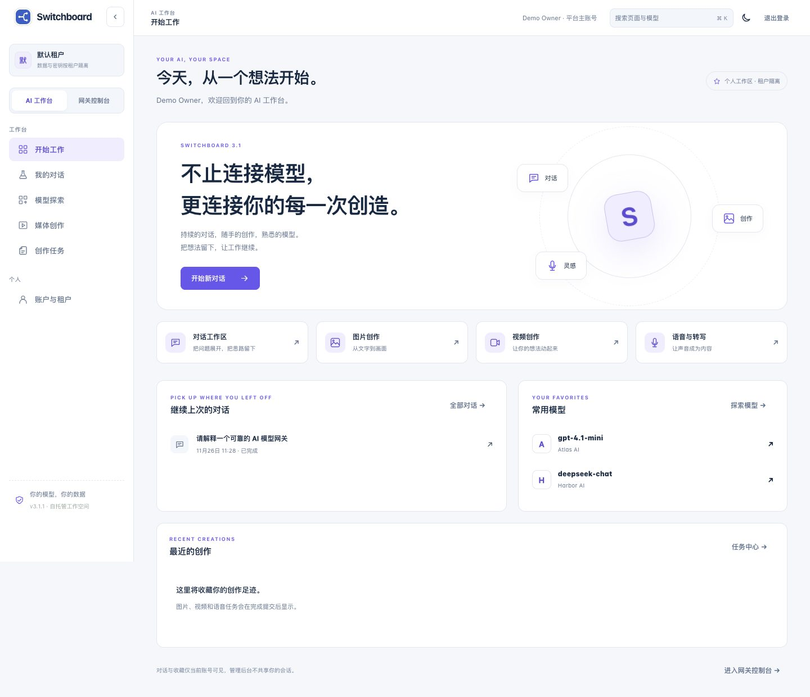
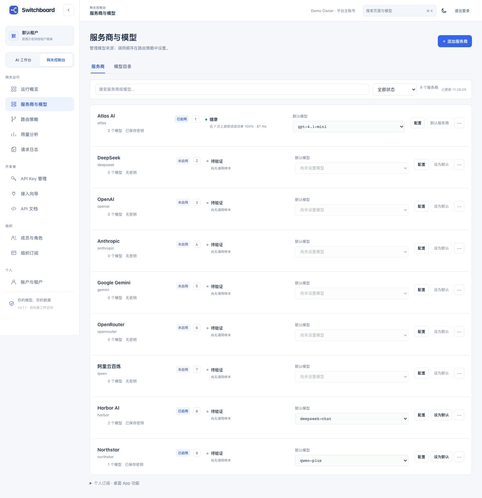
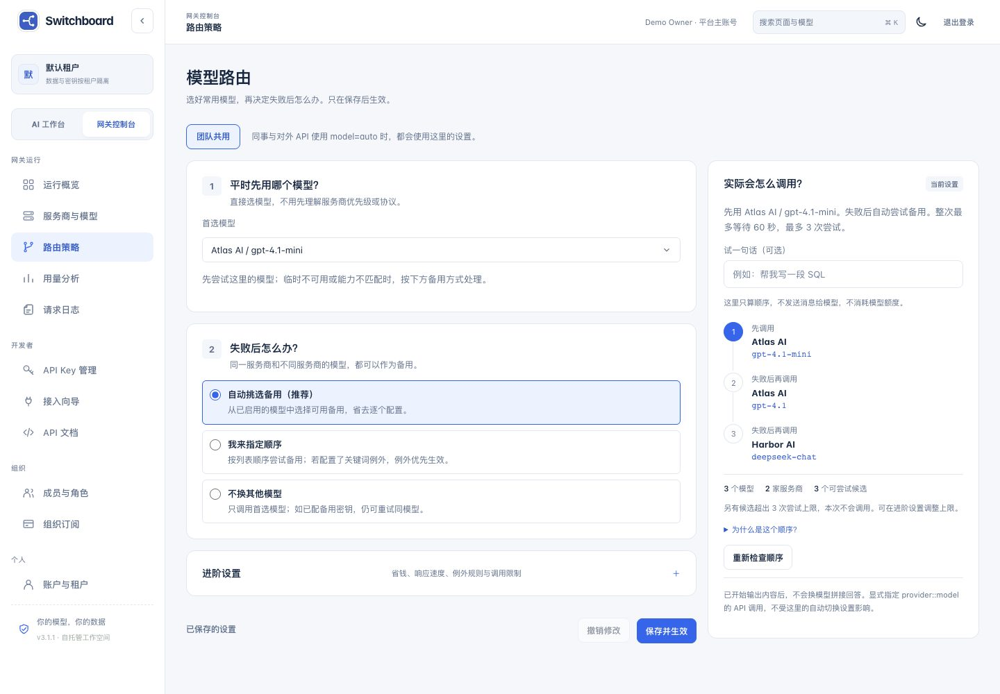
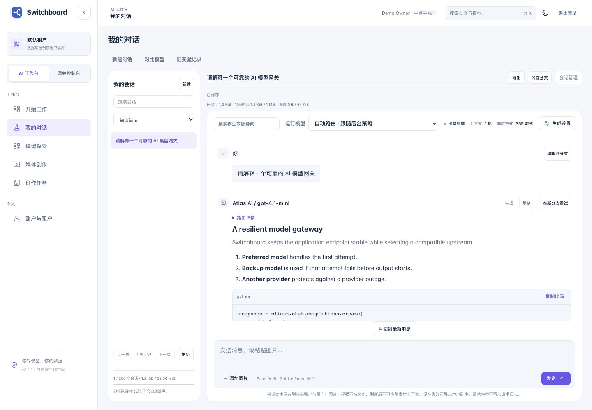
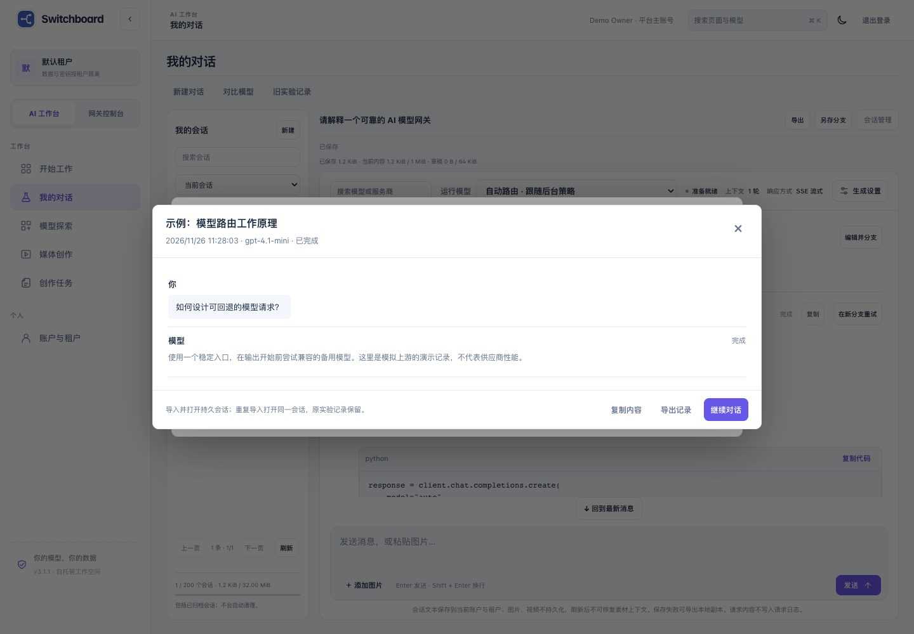
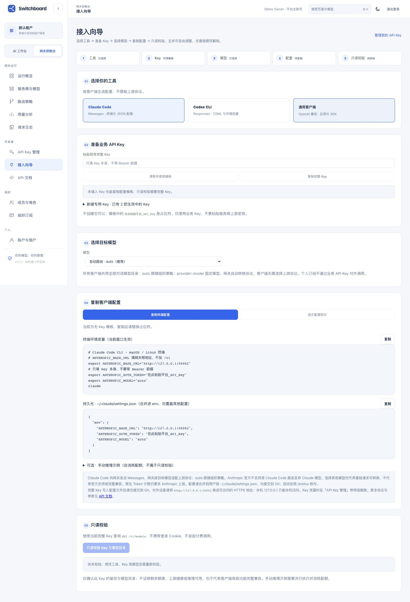
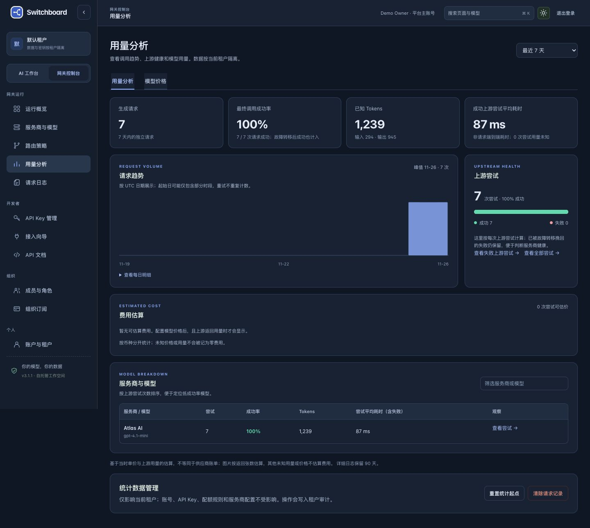

# Switchboard

自托管的 **AI 工作台与模型路由网关**。在工作台保存个人会话和草稿，在网关管理服务商、路由、业务 API Key、成员与用量；用一个 OpenAI／Anthropic 兼容入口调用已配置模型，并明确协议、权限和计费边界。

[English](README.md) | **中文文档**

[](https://github.com/chensl139-ok/switchboard-ai-router/actions/workflows/ci.yml)
[](https://github.com/chensl139-ok/switchboard-ai-router/releases/latest)
[](LICENSE)
[](https://github.com/chensl139-ok/switchboard-ai-router/pkgs/container/switchboard-ai-router)

**版本：3.1.2 · 2026-11-26。** 本版为创作任务增加可靠删除，支持卡片与详情操作，并保留此前工作台和持久会话能力。源码与发布镜像是独立交付物，升级前请核对版本标签；可用版本以实际 [GitHub Releases](https://github.com/chensl139-ok/switchboard-ai-router/releases) 为准。[更新记录](CHANGELOG.md) · [升级与迁移](docs/OPERATIONS.md)

## 看一遍完整流程

导览使用隔离演示账号与模拟上游，不含真实租户数据。**数字不是性能基准**；截图重现与更新检查见[演示说明](docs/demo/README.md)。

[](docs/demo/workspace.jpg)

| ① 连接服务商与模型 | ② 配置路由与备用 |
| --- | --- |
| [](docs/demo/providers.jpg) | [](docs/demo/routing.jpg) |
| 启用所需模型，凭据保存在服务端。 | 选择首选与备用，不调用上游即可预览尝试预算和覆盖。 |
| **③ 在会话中工作** | **④ 查看历史快照** |
| [](docs/demo/playground.jpg) | [](docs/demo/history.jpg) |
| 个人持久会话、草稿、Markdown 与实际命中模型。 | 短期实验历史与持久会话分开保存，不混用保留规则。 |
| **⑤ 接入客户端** | **⑥ 查看调用与用量** |
| [](docs/demo/connect.jpg) | [](docs/demo/analytics.jpg) |
| 使用自己的业务 Key；CLI 兼容范围见 API 文档。 | 区分最终成功、上游失败尝试与调用方输出验收。 |

无需模型密钥即可体验：`npm ci && npm run demo`。只监听本机，使用临时数据和模拟上游，不产生模型费用；不要输入敏感信息。

## 工作台与网关双区

- **工作台**：个人会话与草稿、搜索／置顶／归档／删除、模型收藏、媒体任务和模型对比。会话和收藏按**当前用户 + 当前租户**隔离，不是组织共享内容。
- **网关**：组织服务商、模型目录、路由、业务 Key、成员、日志、价格与用量；`⌘K` / `Ctrl+K` 按权限搜索页面及可用模型。
- **自托管 BYOK**：服务商凭据 AES-256-GCM 加密落盘，业务 Key 哈希保存。请求／操作审计日志不保存提示词和回复正文，**会话、草稿与实验历史会保存文本**，宿主机和备份必须受保护。
- **单实例**：一个 Node.js 进程，配置与账户使用文件，调用用量及工作台记录使用 SQLite；不要让多个进程或容器同时读写同一数据目录。

### 持久会话不是短期历史

点击「新会话」仅打开本地空白草稿，不立即落库；普通自动保存从首次输入文字开始，明确发送、修改元数据或创建分支也可触发保存。新会话标题由首条用户文本在本地生成，不调用模型、不产生标题费用；旧标题和手动标题受保护，`titleMode` 由服务端管理。

编辑用户消息会创建**新分支草稿**，不会自动发送；助手重试必须确认可能产生的费用，并创建新分支，不覆盖原回答。支持 JSON／Markdown／文本导出，Markdown 和文本默认不含思考；JSON 可能包含已保存的思考与元数据，分享前应检查。

图片、视频、音频等输入素材不永久保存。刷新后缺失附件或工具上下文时，不能继续原上下文；文本存档不等于完整多模态备份。媒体任务的**查询状态**和**重新生成**分开，重新生成是新的可能计费请求，结果 URL 可能过期，应及时下载。创作任务卡片和详情均可**删除记录**：仅清理本人当前租户的本地历史，不取消上游、不退款、不清除外部文件或用量日志；处理中任务仍可能继续计费。[创作任务界面](docs/demo/tasks.jpg)。

保存采用 `revision` CAS（比较后写入）；生成绑定 `runId` 和 120 秒租约，客户端每 25 秒续租，输出检查点按 5 秒间隔保存。冲突要求重新加载核对，不静默覆盖。删除不会新建再保存一条替代记录：404 清除本地失效项，409 要求重新加载并再次确认，网络失败保留本地副本。创建响应丢失、无法确定是否落库时，应先导出本地内容、刷新并按 ID 核对，不按标题猜测删除。

| 持久会话限制 | 范围 |
| --- | --- |
| 单会话 1 MiB，含草稿和设置 | 序列化文本载荷 |
| 单草稿 64 KiB | UTF-8 字节 |
| 200 条／32 MiB | 每个用户在当前租户内，包含已归档会话 |
| 256 MiB／1 GiB | 单租户／全局会话载荷合计 |

达到限制会拒绝保存，**不会静默裁剪会话**。旧 `history` 仍是短期实验快照：每用户／租户最近 100 条，全局 5000 条，与 `conversations` 无关。仅完整、已结束且没有缺失素材／工具的文本快照可显式导入为会话，原记录保留；不是全量自动迁移。详见[会话 API](API.md#工作台会话与偏好接口)及[首次工作台迁移](docs/OPERATIONS.md#首次工作台升级与数据迁移)。

## 五分钟部署

需要 Docker + Compose，以及用于生成初始配置的 Node.js **≥ 22.18**。以下构建当前检出的源码，不会自动选择最新正式版本。

```sh
git clone https://github.com/chensl139-ok/switchboard-ai-router.git
cd switchboard-ai-router
npm run setup
docker compose up -d --build
docker compose ps
```

`npm run setup` 仅在 `.env` 不存在时生成初始令牌，不覆盖已有配置。默认访问 [http://127.0.0.1:3100](http://127.0.0.1:3100)，就绪检查 `/readyz`。首次用本机 `ADMIN_TOKEN` 初始化所有者，再设置邮箱和密码。**不要分享令牌或把 `.env` 提交到仓库。** Compose 挂载当前目录 `data/`，容器内部监听 3000。

1. **服务商与模型**：添加上游 Base URL 和 API Key，获取目录，勾选需要开放的模型；支持备用密钥。
2. **路由策略**：选择首选、自动备用／指定顺序／不换模型。草稿预览不保存、不调用上游；确认后保存生效。
3. **工作台**：测试对话、查看实际命中与错误，或选择对应的媒体任务入口。
4. **API Key 管理**：所有者、管理员和成员均可创建并管理自己的 Key，设置有效期和配额；明文仅创建时显示一次。初始化令牌不是业务 Key，只读角色不能调用。

```sh
curl -i http://127.0.0.1:3100/v1/chat/completions \
  -H 'Authorization: Bearer YOUR_API_KEY' \
  -H 'Content-Type: application/json' \
  -d '{"model":"auto","messages":[{"role":"user","content":"你好"}],"stream":false}'
```

| `model` 写法 | 含义 |
| --- | --- |
| `auto` | 跟随本租户路由策略，可回退到兼容候选 |
| `provider-id` | 使用该服务商当前模型 |
| `provider-id::model-id` | 固定服务商及模型，仅同模型备用密钥容灾 |

成功响应含 `x-router-provider`、`x-router-model`、`x-router-protocol`、`x-router-attempt` 等头，文本值使用 URL 编码。实验室具体模型可作为回退起点，与 API 固定 `provider::model` 不同。OpenAI 兼容客户端使用 `http://127.0.0.1:3100/v1` 与业务 Key。

Responses 是**无状态子集，不保证完整 Codex 兼容**；非 Claude 模型的协议转换不等于 Anthropic 官方支持 Claude Code。SDK、CLI 和工具边界见 [API.md](API.md#sdk)，需鉴权的 OpenAPI 位于 `/v1/openapi.json`。

### 使用预构建镜像

**仅在 3.1.2 已实际发布后**使用下列固定版本示例。在仓库目录初始化配置，再拉取 `linux/amd64` 或 `linux/arm64` 镜像：

```sh
npm run setup
mkdir -p data
docker pull ghcr.io/chensl139-ok/switchboard-ai-router:3.1.2
docker run -d --name switchboard-ai-router \
  --restart unless-stopped \
  -p 127.0.0.1:3100:3000 --env-file .env \
  -e HOST=0.0.0.0 -e PORT=3000 -e DATA_DIR=/app/data \
  -v "$PWD/data:/app/data" \
  ghcr.io/chensl139-ok/switchboard-ai-router:3.1.2
```

`docker run` 与 Compose **二选一**，不能同时占用端口或挂载同一数据目录。重建已有容器须保留原参数、令牌和挂载。Release 附件包括源码 ZIP／TGZ、离线 OCI 镜像包和 `SHA256SUMS`；升级与回退见 [运维说明](docs/OPERATIONS.md)。

不用 Docker 时运行 `npm ci && npm run setup && npm start`；源码默认端口 3000，可在本地配置 `HOST=127.0.0.1`、`PORT=3100`。

### Docker 网关与桌面个人订阅的边界

Docker 提供组织 BYOK API 网关与浏览器工作台，**不是个人订阅账号池**，不会把个人订阅通过共享服务商或业务 Key 对外开放。

[macOS 桌面 App](desktop/README.md) 内置 Node、使用系统 WebKit，面向 macOS 13+ Apple Silicon；目前未完成 Apple Developer ID 签名与公证，其他电脑可能出现安全拦截。DMG 不含个人账号、密钥或历史；每台安装都是独立平台，不自动共享组织数据。Windows 用户可使用 [Windows x64 桌面包](desktop/windows/README.md)，解压后运行 Setup.exe，使用系统 WebView2；未代码签名，由主分支手动工作流生成，不自动附加到已有 Release。

本机桌面个人 ChatGPT 订阅连接预览使用官方 OAuth，连接仅属授权用户及当前租户。个人路由可组合本人授权的订阅模型与组织 API 模型，仅影响个人实验室调用，不修改共享路由、不向业务 Key 或其他成员开放。正文开始后不切换模型，未知订阅价格不按免费处理。早期本机验收不代表每个账号或本次发布均已通过；本次文档不宣称新的真实 OAuth／上游调用结果。Claude 订阅未取得官方第三方授权，不等同于已支持的 Anthropic API。

## 路由、媒体与团队能力

| 模块 | 能力与边界 |
| --- | --- |
| 模型路由 | 固定、故障转移、加权、延迟优先、关键词、经济优先；服务商内与跨服务商候选、主备密钥 |
| 协议网关 | OpenAI Chat／无状态 Responses／Legacy Completions、Anthropic Messages、SSE、自建 WebSocket 文本协议；不是官方 Realtime |
| 对话与对比 | Markdown、图片、调用方执行的函数工具、2–4 模型同题对比；实际模型及 TTFB／TTFT／TPS／估算 TPOT |
| 媒体 | 图片、音频、视频和视觉理解；API 另有编辑、翻译、嵌入、重排，取决于上游能力 |
| 团队 | 邮箱密码、可选飞书 OAuth、邀请、四种角色、租户隔离、审计和密码重置码 |
| 任务追踪 | 普通 HTTP／SSE 对话的 `X-Task-ID`、独立输出验收、任务耗时与分币种估算费用；[接口说明](API.md#任务关联输出验收与成本追踪) |
| 观测 | 个人业务 Key 配额、调用元数据、最终请求成功率、成员／模型／Key 用量及参考价格 |

路由预览展示有效覆盖和排除原因。延迟排名至少需要 3 条近期模型级成功样本；经济优先仅比较有效同币种价格，未知不当成免费。尝试预算包含备用凭据，总超时仅分配给真实剩余候选。已输出的流不拼接另一模型回答。最终成功率衡量网关调用完成，不代表通过调用方业务验收。

TPS 包含首字延迟和可能的回退；TPOT 根据流式增量与上游用量估算，并非供应商精确逐 Token 解码耗时。缺少可靠数据时显示「—」，非流式完整响应不能测量 TTFT／TPOT。工具由调用方验证、执行并回传，网关不执行模型生成的代码。

**媒体边界**：指定已配置的媒体模型，不使用对话 `auto`；视频生成当前适配硅基流动异步接口。MOSS-VL 是同步单轮视觉任务，不进入普通文本对话；MOSS 图片支持水印、提示词增强、种子等参数，仍受具体上游能力约束。本说明不代表本次已通过真实供应商调用。

**Kimi K3 视频理解**：对话支持带时间戳抽帧及素材仍在时的追问；媒体视觉理解支持 MP4／WebM／MOV，最多 6 MB／10 分钟、12 帧，不含音轨，可能遗漏短暂事件。原生 `video_url` 是否支持由上游决定；`ms://` 必须来自同上游账户并使用固定 `provider::kimi-k3`、`allow_fallback: false`。平台不代理上游上传接口，详见 [API 文档](API.md#kimi-k3-视频理解)。

「组织订阅」仍是**不启用付费墙的 BYOK 框架**：支持套餐草案与内部试用分配，规划权益仅展示、不执行，无支付、充值或自动续费。参考价格不是结算账单；OpenRouter 导入价格低于手动价和服务商自身价的优先级。

首次初始化账号为平台主账号，跨租户权限按登录来源核验；普通成员只能使用所属租户。飞书企业自建应用各自映射独立租户，已有账号须主动连接，不按同邮箱自动合并。**升级保留飞书绑定和凭据配置，本次未验证真实飞书扫码 OAuth。** 回调域名、应用可用范围和默认租户身份需单独验收，详见 [TENANCY.md](TENANCY.md)。忘记密码由管理员签发一次性重置码，系统不自动发邮件。

## 安全、升级与镜像渠道

- 公网部署放在 HTTPS 反向代理后并启用 `COOKIE_SECURE=true`。Compose 默认只绑定本机，含只读根文件系统、tmpfs、健康检查等设置。
- 默认拒绝非 HTTPS、私网及保留地址上游；仅通过精确白名单放行受信任服务。Fake-IP 例外不等于放开所有私网，详见 [安全设置](TENANCY.md#部署与安全设置)。
- **停机备份完整 `data/`，尤其是 `master.key` 和 SQLite 文件，并保护 `.env`。** 备份含敏感内容；丢失主密钥无法解密上游凭据。不要多个实例共用目录。
- 现有配置说明见 [.env.example](.env.example)；升级不要重新生成已有令牌或覆盖飞书配置。回退必须恢复配套旧备份，不让旧代码直接打开新结构。

| 标签 | 内容 | 更新方式 |
| --- | --- | --- |
| `3.1.2`、`3.1`、`latest` | 目标正式版，工作流成功发布后才可用 | `v*` 标签 → 校验测试 → 双架构 GHCR → Release 附件 |
| `main` | 最近一次手动发布的主分支构建，非正式版 | 在 main 手动触发 [Main branch image](https://github.com/chensl139-ok/switchboard-ai-router/actions/workflows/image-main.yml) |
| `sha-<完整提交 SHA>` | 可追溯的主分支构建 | 同一流程；精确固定建议使用 digest |

仓库统一为 `ghcr.io/chensl139-ok/switchboard-ai-router`，支持 `linux/amd64`、`linux/arm64`。主分支镜像不覆盖 `latest` 或版本标签、不创建 Release；仅推送 main 运行 CI，不发布镜像。Windows 安装包是独立[工作流附件](https://github.com/chensl139-ok/switchboard-ai-router/actions/workflows/windows-desktop.yml)，保留 14 天。

## 核对实例与可重复验证

App 与 Docker 共用核心代码、独立保存数据；更新本机不等于更新公网实例。版本号相同也不一定是同一构建，详见[运维与迁移](docs/OPERATIONS.md)。

```sh
npm ci
npm run check          # 语法、TypeScript/Vue 类型与前端构建
npm test               # 自动化测试，结果以实际运行输出为准
npm start              # 构建并启动本地服务
npm run demo           # 独立模拟环境
npm run doctor -- --url http://127.0.0.1:3100
# 使用 App 菜单显示的实际端口：
npm run doctor -- --url http://127.0.0.1:3100 --url http://127.0.0.1:3110
```

Doctor 无需登录，只读就绪状态与构建指纹，不调用模型。指纹一致不代表数据同步或具备桌面专属能力。

`scripts/smoke.mjs` 默认检查就绪和模型目录，`--live` 会发起可能计费的真实调用；仅在授权后运行：

```sh
SWITCHBOARD_TOKEN=YOUR_API_KEY node scripts/smoke.mjs
SWITCHBOARD_TOKEN=YOUR_API_KEY node scripts/smoke.mjs --live
```

本版通过 374 项自动化测试和浏览器流程，并完成一次经授权的受限真实文本调用；模拟媒体测试不等于真实供应商性能、计费或完整 OAuth 验证，详见[功能验收矩阵](docs/VALIDATION.md)。发布步骤见 [.github/RELEASING.md](.github/RELEASING.md)，普通提交不会自动发布新版本。

相关文档：[API](API.md) · [租户与飞书](TENANCY.md) · [架构](ARCHITECTURE.md) · [运维](docs/OPERATIONS.md) · [更新记录](CHANGELOG.md) · [GitHub Issues](https://github.com/chensl139-ok/switchboard-ai-router/issues)。

## 合规声明

Switchboard 是中立的自托管路由工具。请遵守模型服务商条款及适用法律法规；未经授权，不要基于本项目向公众提供生成式人工智能服务。界面可配置不代表供应商官方背书或完整客户端兼容。

## Star History

如果 Switchboard 帮助了你，欢迎 Star 支持。

[](https://star-history.com/#chensl139-ok/switchboard-ai-router&Date)

## License

[MIT](LICENSE) © 2026 chensl139-ok
